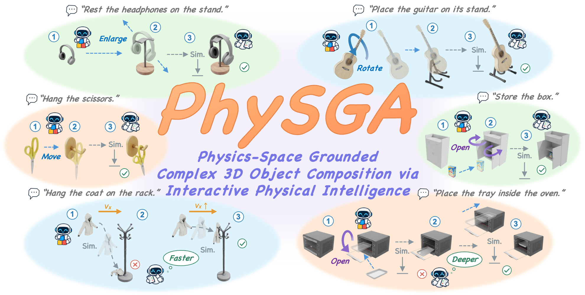
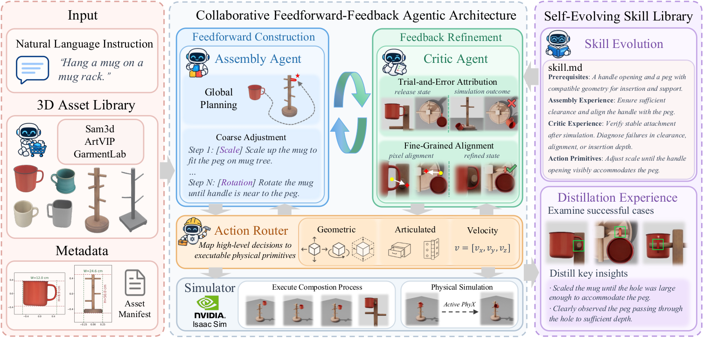

<div align="center">

# PhySGA

### A Physics-Space Grounded Agentic Framework for Generalizable and Interactive 3D Composition

[](https://arxiv.org/abs/2610.20560)
[](https://agenticei.github.io/PhySGA-page/)
[](LICENSE)

**[Weichen Lyu](https://matthew-lyu.github.io/)<sup>1,&#42;</sup>, [Chong Xia](https://xiac20.github.io/)<sup>1,&#42;</sup>, [Mingyu Dong](https://dongmingyu111.github.io/)<sup>1</sup>, [Long Xu](https://gaolon.github.io/xulong/)<sup>2</sup>, [Shengjun Zhang](https://shengjun-zhang.github.io/)<sup>1</sup>, [Yueqi Duan](https://duanyueqi.github.io/)<sup>1,†</sup>**<br>
<sup>1</sup>Tsinghua University · <sup>2</sup>Zhejiang University<br>
<sup>&#42;</sup> Equal contribution · <sup>†</sup> Corresponding author

</div>



## Overview

3D object composition aims to construct physically and functionally coherent interactions among independent object assets. Previous methods predominantly formulate this task as a one-shot prediction of final relative object poses, bypassing the physical interaction trajectory. However, complex compositions inherently depend on continuous contact dynamics and intermediate state transitions.

PhySGA formulates 3D object composition as an interactive assembly process in physical space. Starting from an initial simulator state, the composition is achieved through a sequence of state transitions, including geometric transformations, dynamic velocity assignments, and physical simulation. This formulation supports interactive composition across rigid, articulated, and deformable objects.

## Method



PhySGA uses a collaborative Feedforward-Feedback architecture to separate global construction from physical correction:

1. **Feedforward construction.** The Assembly Agent leverages geometric and kinematic reasoning to formulate a global plan and execute metric-grounded coarse adjustments.
2. **Feedback refinement.** The Critic Agent analyzes simulated motion and contact feedback to diagnose physical failures, performing pixel-grounded fine-grained corrections until the target relation reaches physical equilibrium.
3. **Action routing.** The Geometric, Articulated, and Velocity Routers ground the agents' semantic targets and adjustment analyses into executable geometric transformations, joint movements, and release velocities.
4. **Skill evolution.** The Self-Evolving Skill Library retrieves compatible knowledge before a new task and distills the complete interaction memory and final physical outcome into reusable skills after execution.

## Citation

```bibtex
@misc{lyu2026physga,
      title={PhySGA: A Physics-Space Grounded Agentic Framework for Generalizable and Interactive 3D Composition}, 
      author={Weichen Lyu and Chong Xia and Mingyu Dong and Long Xu and Shengjun Zhang and Yueqi Duan},
      year={2026},
      eprint={2610.20560},
      archivePrefix={arXiv},
      primaryClass={cs.AI},
      url={https://arxiv.org/abs/2610.20560}, 
}
```
