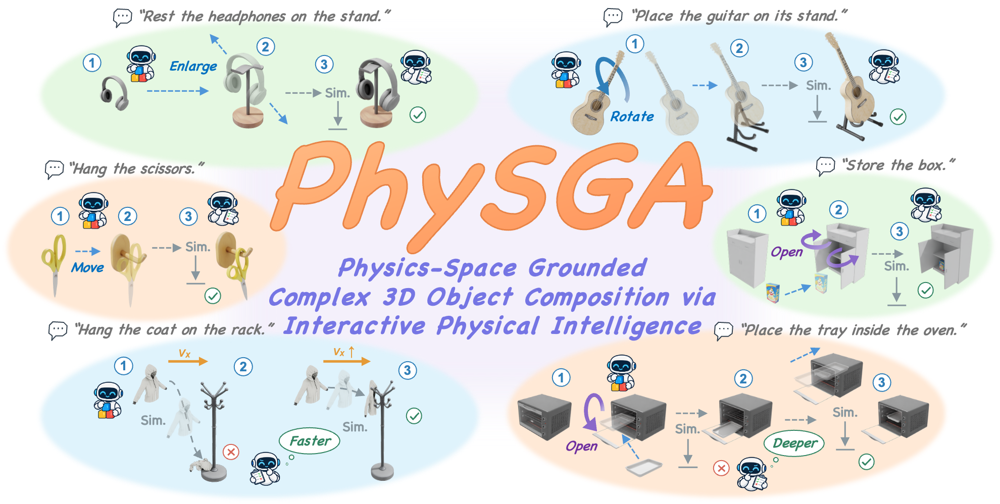

# PhySGA

### A Physics-Space Grounded Agentic Framework for Generalizable and Interactive 3D Composition

**[Weichen Lyu](https://matthew-lyu.github.io/)1,*, [Chong Xia](https://xiac20.github.io/)1,*, [Mingyu Dong](https://dongmingyu111.github.io/)1, [Long Xu](https://gaolon.github.io/xulong/)2, [Shengjun Zhang](https://shengjun-zhang.github.io/)1, [Yueqi Duan](https://duanyueqi.github.io/)1,†** 
1Tsinghua University · 2Zhejiang University 
* Equal contribution · † Corresponding author

## News

<!-- News will be added after the arXiv release. -->

## Overview

PhySGA is a physics-space grounded agentic framework for generalizable and interactive 3D object composition. It treats 3D object composition as an interactive construction process in physical space, where an agent must plan the composition process, execute precise adjustments, observe physical outcomes, and refine the scene from simulation feedback.

The framework supports rigid, articulated, and deformable objects within a unified pipeline. A collaborative feedforward-feedback architecture separates global construction from fine-grained physical correction, while specialized Action Routers translate semantic decisions into executable simulator commands. A Self-Evolving Skill Library further distills experience from completed compositions into reusable task-specific guidance.

## Method

PhySGA organizes 3D object composition into two complementary stages:

1. **Visual feedforward construction.** The Assembly Agent reasons about object geometry and kinematics, produces a chain-of-thought assembly plan, and executes metric-grounded coarse adjustments toward a physically meaningful release state.
2. **Physical feedback refinement.** Physical simulation reveals contact, stability, articulation, and deformation outcomes. The Critic Agent diagnoses the simulated result and performs pixel-grounded fine-grained refinement until the objects establish the stable relation specified by the instruction.

Throughout both stages, **Action Routers** convert the agents' semantic decisions into executable geometric operations, joint motions, and release velocities. After a composition succeeds, the **Self-Evolving Skill Library** summarizes the complete interaction experience for reuse in subsequent tasks.
